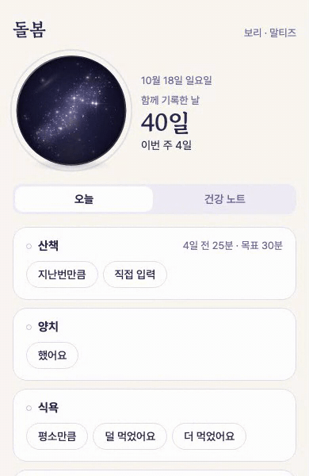
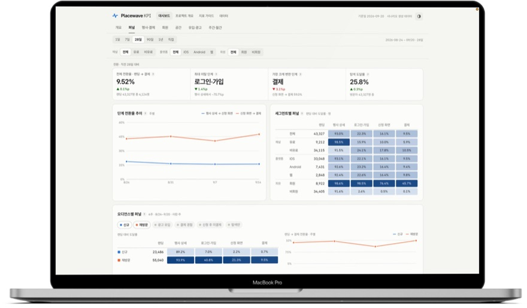

  
  
  
  

3년 8개월간 데이터 분석 · 지표 체계 · 운영 개선을 맡았고, 지금은 AI 서비스를 직접 만들어 배포하고 있습니다.
AI 에이전트에 여러 작업을 나눠 맡기고, 가설 검증과 최종 판단은 제가 맡는 방식으로 일합니다.

- **수집·분석·시각화 전체를 실제 활용 환경으로 구축** — Sheets → BI 자동 연결, BigQuery → 웹 대시보드 배포
- **이해관계자를 설득하고 성과까지 책임지는 실행** — CAPA 분석 → 1.5배 증원 합의, 공정 기준 150명 재배치
- **가설에서 출발해 검증으로 끝나는 AI 구현** — 기준과 우선순위를 먼저 정하고, 작게 만들어 수치로 확인

## 프로젝트

| 프로젝트 | 상태 | 증거 | 주요 스택 |
|---|---|---|---|
| PetGlobe | 배포 중 · [petglobe.app](https://petglobe.app) | 기억 회상 근거 56% → 83% | React · three.js · FastAPI · LangGraph · Langfuse |
| HeartTable | 배포 중 · [hearttable.shop](https://hearttable.shop) | 첫 대화 응답 12.1초 → 1.3초 | Next.js · FastAPI · Firebase · Langfuse |
| Murder Mystery Generator | 배포 중 · [murdermysterygenerator.shop](https://murdermysterygenerator.shop) | 1차 완성 평균 약 8시간 · AI 대화 비용 −82% | Next.js · Supabase · LangChain · Gemini 2.5 Flash · Langfuse |
| Placewave | 배포 중 · [placewave-analytics.vercel.app](https://placewave-analytics.vercel.app) | 가상 플랫폼 데이터를 BigQuery 네 층으로, 검색 실패 → 라벨링 → 랭킹 개선 | BigQuery · LightGBM · React · Recharts · Vercel |
| 공공입찰 RFP 분석 RAG | 팀 프로젝트 | 질문 유형별 라우팅으로 응답 20.3초 → 10.9초 | LangChain · ChromaDB · gpt-5-mini · LLM judge |
| 의약품 인식·음성 안내 | 팀 프로젝트 | 알약 탐지 mAP 0.79 → 0.99 | YOLOv11s · 앙상블 |
| 소상공인 숏폼 영상 생성 | 팀 프로젝트 | 생성 옵션을 템플릿 9종으로 구조화 | Wan2.1-VACE · diffusers |

<table>
  <tr>
    <td width="33%" valign="top">
      
      
<strong>PetGlobe</strong> 일상 기록이 이별 대비가 되고, AI가 그 기록으로 회상 대화

      
<a href="https://petglobe.app">petglobe.app</a>

    </td>
    <td width="33%" valign="top">
      
      
<strong>HeartTable</strong> 고르기 전에 짧게 만나 보는 AI 캐릭터 소개팅

      
<a href="https://hearttable.shop">hearttable.shop</a>

    </td>
    <td width="33%" valign="top">
      
      
<strong>Placewave</strong> 퍼널부터 검색 품질까지 한 화면에서 보는 대시보드

      
<a href="https://placewave-analytics.vercel.app">placewave-analytics.vercel.app</a>

    </td>
  </tr>
</table>

## 경력

| 기간 | 회사 · 역할 | 한 줄 |
|---|---|---|
| 2026.08 – 09 | 비트버디 · DA | GA4·광고·DB 통합 대시보드 1인 구축, 가입 후 이탈 36.6%의 원인 특정 |
| 2025.04 – 07 | 브레이브모바일(숨고) · FP&A 챕터 BA | 전사 KPI 대시보드·로그 분석으로 보너스 캐시 부채 30% 절감 기여 |
| 2021.04 – 2024.06 | 페이머스랩(KREAM) · 검수센터 정보관리팀 파트장 | CAPA 측정으로 증원 규모 산출, 연장근무 시간 −75% |

## 기술

SQL · BigQuery · Redash · Python · LightGBM · YOLO · React · Next.js · FastAPI · LangChain · LangGraph · Langfuse · Supabase · Firebase · Vercel

## 공개 레포

- [placewave-analytics](https://github.com/youuuchul/placewave-analytics) — 가상 플랫폼 KPI 대시보드 · A/B 테스트
- [sql-jd-trainer](https://github.com/youuuchul/sql-jd-trainer) - 데이터 분석가 jd 기반 연습 문제 SQL 에디터 (비즈니스 시나리오, 데이터셋, 문제/가설 시나리오 등 고도화 예정)
- [study-log](https://github.com/youuuchul/study-log)
- [i2v-motion-experiments](https://github.com/youuuchul/i2v-motion-experiments) — 이미지 → 영상 모델 실험
- [Deep-Learning-Archive](https://github.com/youuuchul/Deep-Learning-Archive)
